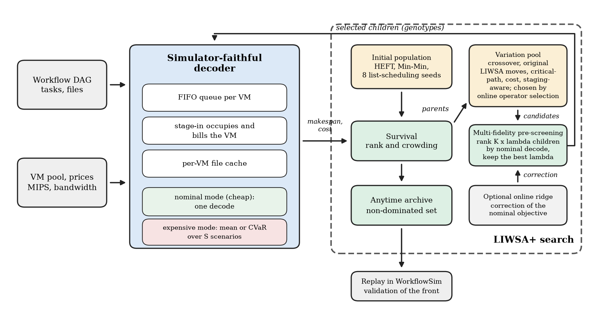
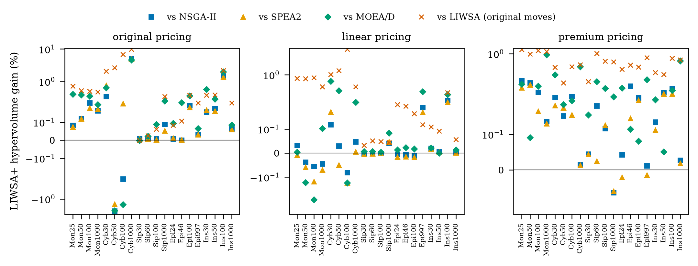
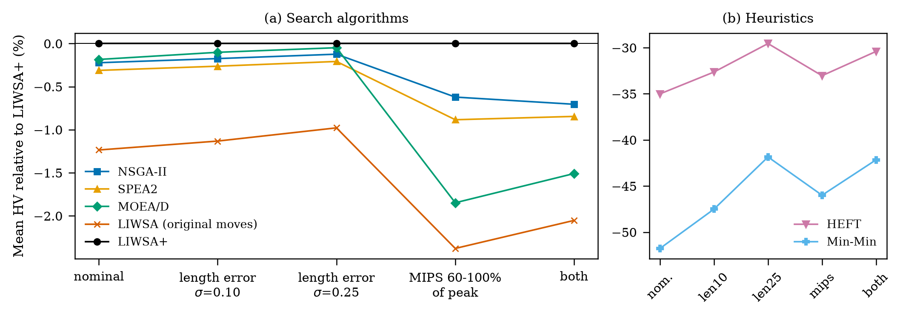
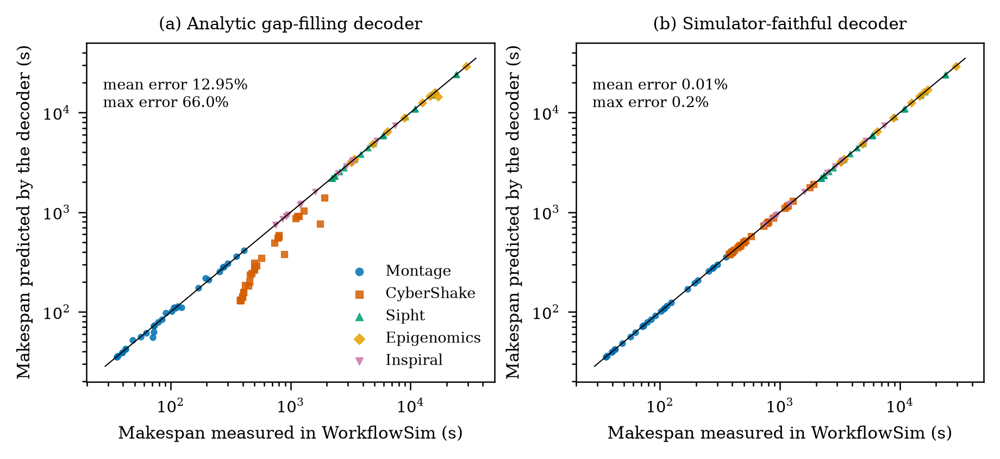
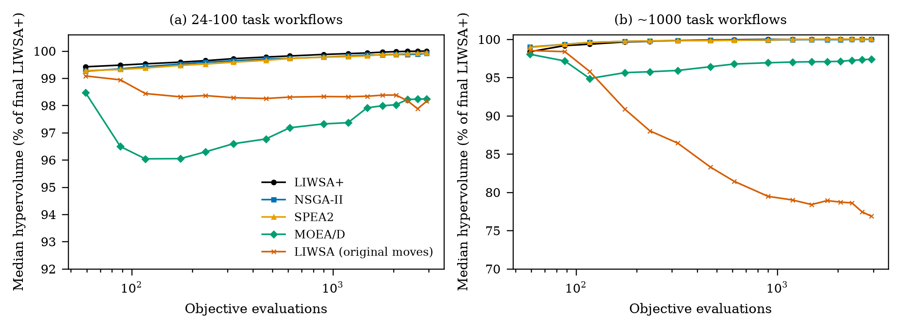

<div align="center">

# LIWSA-MF

### Multi-fidelity, risk-aware scheduling for scientific workflows


**Dr. Mohammed Alaa Ala'anzy**  
SDU University, Kaskelen, Kazakhstan  
📄 **Manuscript status:** Under review

[](https://openjdk.org/)
[](https://www.python.org/)
[](https://github.com/WorkflowSim/WorkflowSim-1.0)
[](#research-focus)
[](#reproducing-and-interpreting-results)

</div>

---

## 🔭 At a glance

LIWSA-MF2 is a research codebase for evaluating workflow schedulers under
multi-objective and risk-aware settings. It includes the LIWSA method,
the guided **LIWSA+** search (The novelty), simulator-faithful scheduling, competing
multi-objective algorithms, benchmark workflows, and scripts to regenerate
reports, tables, and plots.

The package contains **20 Pegasus workflow definitions** from five workflow
families. It includes reference experiment outputs and the scripts needed to
reproduce the analyses.

## 🧭 Research focus

Workflow scheduling is a multi-objective problem: a schedule that minimizes
completion time may cost more, while a cheaper schedule may take longer or be
more vulnerable to uncertain execution times and slow virtual machines. This
work studies a Pareto-based search approach for exploring those trade-offs,
then examines whether more faithful simulation and multi-fidelity evaluation
can make the search results more reliable and efficient.

### 🧠 Methodology

1. **Represent a schedule.** A candidate maps each workflow task, in
   topological order, to a virtual machine.
2. **Optimize competing objectives.** The search evaluates makespan and
   execution cost together, preserving non-dominated alternatives rather than
   collapsing them into a single weighted score.
3. **Explore alternative assignments.** LIWSA uses density-adaptive solitary
   and social search moves. LIWSA+ combines these with canonical evolutionary,
   critical-path, cost-directed, and estimate-guided moves.
4. **Preserve and adapt.** LIWSA+ uses Pareto-rank and crowding-based
   population survival, maintains an archive of evaluated non-dominated
   schedules, and adapts variation-operator selection based on observed
   contributions during the run.
5. **Evaluate fidelity and risk.** A simulator-faithful decoder models
   WorkflowSim scheduling behavior, including stage-in, per-VM input-file
   caching, and FCFS execution. Risk-aware experiments evaluate schedules
   across perturbed task lengths and machine speeds; CVaR can emphasize poor
   makespan outcomes in the scenario tail.
6. **Test multi-fidelity screening.** When full scenario evaluation is
   expensive, candidate pools can be screened using nominal decoder values,
   online ridge models, or boosted trees before selected candidates receive
   expensive evaluation. Random-selection controls and equal-budget
   comparisons are included.

### ✨ Research contributions examined

The repository implements and evaluates the following methodological
elements. These describe the scope of this work; they are not a claim that
each element is individually unprecedented:

- **A density-adaptive, Pareto-based LIWSA search** for discrete
  task-to-machine assignments, together with a population-based LIWSA+
  extension.
- **Search operators informed by schedule structure:** critical-chain moves
  target tasks contributing to the current makespan, while cost moves consider
  machine price per unit of work.
- **Online adaptive operator selection** and an anytime archive of
  non-dominated solutions, with ablations to examine component effects.
- **A simulator-faithful scheduling decoder** validated against full
  WorkflowSim, reducing discrepancies between search-time estimates and
  simulator-measured outcomes.
- **Risk-aware and multi-fidelity evaluation** combining perturbed scenarios,
  CVaR objectives, candidate pre-screening, and learned surrogate models.
- **A reproducible comparative study** against NSGA-II, SPEA2, MOEA/D, HEFT,
  and Min-Min across workflow families, workflow sizes, pricing settings, and
  algorithm ablations.

## 📊 Results

The figures below are generated from the included experiment outputs. Click a
figure to open its PDF version.

<div align="center">
  <a href="RESULTS/figures/fig_framework.pdf">
    
  </a>
  <br>
  <em>Overview of the scheduling and evaluation framework.</em>
</div>

<table>
  <tr>
    <td align="center" width="50%">
      <a href="RESULTS/figures/fig_main_diff.pdf">
        
      </a>
      <br><em>Main algorithm comparison</em>
    </td>
    <td align="center" width="50%">
      <a href="RESULTS/figures/fig_robust.pdf">
        
      </a>
      <br><em>Risk-aware and robustness results</em>
    </td>
  </tr>
  <tr>
    <td align="center" width="50%">
      <a href="RESULTS/figures/fig_fidelity.pdf">
        
      </a>
      <br><em>Decoder fidelity assessment</em>
    </td>
    <td align="center" width="50%">
      <a href="RESULTS/figures/fig_convergence.pdf">
        
      </a>
      <br><em>Search convergence across workflow sizes</em>
    </td>
  </tr>
</table>

### 📌 Selected findings from the included reference run

| Experiment | Reported result |
|---|---|
| **Main comparison** | Under original pricing, LIWSA+ archive hypervolume was **1.40% higher on average** than original LIWSA across 20 workflows; wins/losses **19/1**, Holm-adjusted *p* < 0.001. |
| **Decoder fidelity** | Across 128 comparisons with full WorkflowSim, the simulator-faithful decoder's mean relative error was **0.007% for makespan** and **0.013% for cost**. |
| **Simulator replay** | On 15 replayed instances, LIWSA+ showed a **+1.84% mean hypervolume difference** versus original LIWSA; this paired comparison was **not statistically significant** (*p* = 0.1354). |

These are results from the checked-in reference outputs, not a guarantee of
performance on other workloads or settings. Multi-fidelity surrogate checks
show improved candidate ranking in some configurations, but do **not** show
better final outcomes than nominal pre-screening in the reported checks. See
the full reports and figures before drawing conclusions.

Browse all available plots, tables, and reports in
[`RESULTS/index.html`](RESULTS/index.html) or browse the
[`RESULTS/` folder](RESULTS/).

## 🧰 What’s included

| Area | Contents |
|---|---|
| **Scheduling algorithms** | Original LIWSA, LIWSA+, simulator-faithful decoder, NSGA-II, SPEA2, MOEA/D, and HEFT |
| **Risk and search variants** | Monte Carlo risk objectives, CVaR, candidate pre-screening, learned surrogates, and ablations |
| **Benchmarks** | 20 Pegasus DAX workflows from Montage, CyberShake, Sipht, Epigenomics, and Inspiral |
| **Experiment tooling** | Java experiment runners and Python scripts for running studies, analysis, statistics, and figures |
| **Reference outputs** | Figures, LaTeX tables, statistical reports, and simulation checks |

The reduced `sources/` tree contains the CloudSim/WorkflowSim classes used by
the experiments and the LIWSA planning implementations. The repository does
not include the earlier GNN warm-start code or earlier baselines.

## 🚀 Quick start

### Requirements

- JDK 8 or later (`javac` must be available; set `JAVAC` if it has another name)
- Python 3 with `numpy`, `scipy`, and `matplotlib`
- No GPU or PyTorch required

### Run the quick end-to-end check

From the repository root:

```bash
python run_all.py --quick
```

On Windows, you can also run:

```bat
run_all.bat --quick
```

### Run the complete workflow

```bash
python run_all.py
```

To run the experiment driver directly:

```bash
python experiments/run_experiments.py paper
```

Add `--quick` to the direct experiment command for a smaller run. The complete
paper run takes about 1.5 hours on one core; runtime varies by machine. The
driver is resumable and skips completed work.

The pipeline runs compilation, seed generation, fidelity and robustness
experiments, analysis, and figure generation. Outputs are collected in
`RESULTS/`; intermediate experiment data is written to
`experiments/work/`. Individual stages can also be run directly:
`compile`, `seeds`, `fidelity`, `faithful`, `sensitivity`, `robustness`,
`multifidelity`, `simcheck`, `mlchecks`, and `figures`.

## 🔬 Reproducing and interpreting results

- The included `experiments/reference_results/` contains a complete reference
  run with reports, tables, and figures.
- `RESULTS/index.html` is a convenient local index for browsing the collected
  output.
- Hypervolume reference points are computed from the algorithms present in
  each result file. Adding or removing conditions can therefore change
  percentage gains; compare results from the same complete run.
- Reported timings were measured on one core of the build machine and will vary
  across systems.
- The full `mlchecks` run was completed once for this package. The candidate
  pool-size sweep, harsher tail-risk setting, and hedged selection are limited
  to five development workflows; consult `experiments/reference_results/ml_checks.txt`
  for details.
- Learned surrogates improved ranking quality in the reported checks, but did
  not improve the final result over nominal pre-screening.

## 🗂️ Repository map

```text
config/dax/                       Pegasus workflow inputs
experiments/                      Experiment driver and analysis scripts
experiments/reference_results/    Complete reference reports, tables, figures
sources/                          Reduced simulator sources and scheduling code
RESULTS/                          Collected figures, reports, and LaTeX tables
run_all.py                        Cross-platform pipeline entry point
run_all.bat                       Windows pipeline shortcut
```

To verify a copy against the included manifest, run:

```bash
python experiments/check_install.py
```

## 📜 License and third-party notices

See [`license.txt`](license.txt) and
[`license-workflowsim.txt`](license-workflowsim.txt) for the licensing
information and third-party notices included with the project.
